<!-- BANNER - terminal profile.sh --live (additive). Generated by scripts/banner/generate.py.
     ~0.9 MB each. Cache-bust with ?v=N after regenerating. -->
<picture>
  <source media="(prefers-color-scheme: dark)"  srcset="assets/banner-dark.v9.svg">
  <source media="(prefers-color-scheme: light)" srcset="assets/banner-light.v9.svg">
  
</picture>

 

<!-- NAME / TAGLINE - animated typing -->

 

<!-- SOCIALS -->
&nbsp;&nbsp;
&nbsp;&nbsp;
&nbsp;&nbsp;

---

## About me

Hi, I'm **Mohamed Amine**, a fifth-year engineering student at **EMSI** specializing in **Data & Artificial Intelligence**, based in Morocco 🇲🇦.
I like turning raw data into something people can actually use: clean pipelines, honest models and dashboards that answer real questions.

- 🎓 **Engineering student at EMSI**, Data & AI track (5th year).
- 📊 Interested in **data engineering, analytics & BI, machine learning and generative AI**.
- 🛠️ I build end-to-end projects: ingestion, analysis, modelling, then a clear way to show the results.
- 🧪 My motto: **Learn by building. Improve by testing.**
- 🔎 **Open to a PFE (end-of-studies internship) in 2027**, as well as learning and collaboration opportunities.
- 💬 Talk to me about **data, AI and Morocco-focused open data**.

 

## my stack

  

Data tools: <b>SQL · Power BI · Pandas · scikit-learn · Spark · Kafka · Hadoop</b> &nbsp;|&nbsp; Infra: <b>GCP · Nginx · Docker</b>

---

## signals

<table>
<tr>
<td width="50%" align="center" valign="middle">

<!-- Self-rated radar - edit assets/skills.json, the workflow redraws it -->
<picture>
  <source media="(prefers-color-scheme: dark)"  srcset="assets/radar-dark.svg">
  <source media="(prefers-color-scheme: light)" srcset="assets/radar-light.svg">
  
</picture>

</td>
<td width="50%" align="center" valign="middle">

<!-- Language & stack radar - edit assets/langmix.json -->
<picture>
  <source media="(prefers-color-scheme: dark)"  srcset="assets/radar-langs-dark.svg">
  <source media="(prefers-color-scheme: light)" srcset="assets/radar-langs-light.svg">
  
</picture>

</td>
</tr>
</table>

---

## certifications

Google Data Analytics Professional Certificate · IBM Data Engineering Professional Certificate ·
IBM Data Engineering Foundations · Python 3 Programming (University of Michigan) · People & Soft Skills

---

Learn by building. Improve by testing. · @MedAmine04

